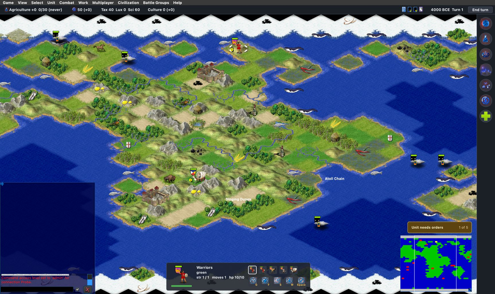

# civ45 on the angled map (issue 188, 2026-10-18)

John prefers the isometric look: "Yes, make Freeciv45 default to the angled map." Labels: observed (seen in a run or
read in the source), inferred.

## What changed

- **Fork, patch 0032:** `data/civ45/game.ruleset` `[settings]` sets `topology` to `"ISO"`, where it was `""`. The tiles
  stay square: movement, the 21-tile fat cross, every rule and `wrap` WRAPX are unchanged. Only the native coordinates
  and the view differ. `[tileset] preferred` stays `""`, and `README.civ45` says so.
- **`scripts/civ45-rules-test.lua`** now expects ISO (the check was "neither ISO nor HEX").
- **`scripts/ui-drive.sh`:** `FREECIV_DRIVE_TILESET=none` passes no `-t`, and `FREECIV_DRIVE_FRESH=1` starts from
  empty client options. Together they act like a player's first start.

## Which tileset a client shows (observed, source and run)

- The Qt client keeps one default tileset for square tiles, iso or overhead (`default_tileset_square_name`;
  `tileset_name_for_topology()` in `client/options.c`). When the server sets the topology, `handle_set_topology()`
  loads that default unless `-t` forced a tileset.
- **Fresh client** (no options file, no `-t`): it starts on hexemplio (the isohex default), then loads
  amplio2 when the civ45 game sets ISO. `client.log`: `Loading tileset "amplio2"`. No suggestion box or other
  window opened (`iso-default-start.jpg`).
- **John's client:** his `~/.freeciv/freeciv-client-rc-3.2` has `default_tileset_square_name="freeciv45test"`, so
  his civ45 games keep showing the overhead freeciv45test until that option changes. An overhead tileset on an ISO
  map is only a soft mismatch, so it still plays (inferred from `tileset_map_topo_compatible()`; not run).

## Checks (observed)

- `scripts/civ45-rules-test.sh` against the patched data: 64/64.
- `scripts/harness-test.sh --ruleset civ45`: PASS. The turn 50 save has `"topology","ISO"`.

