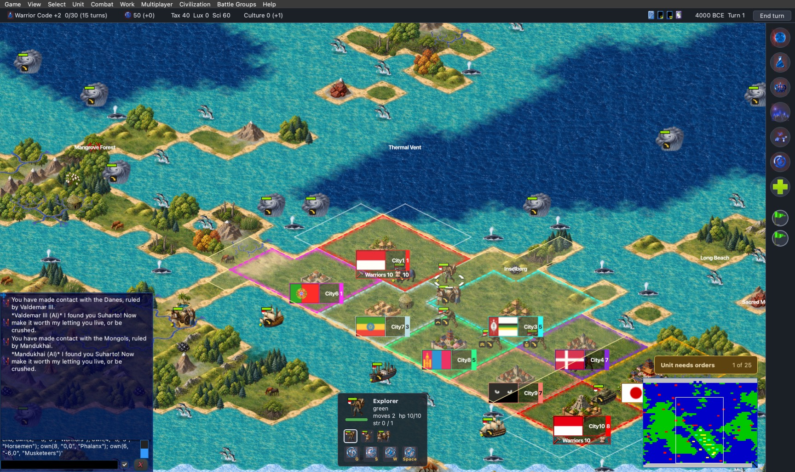
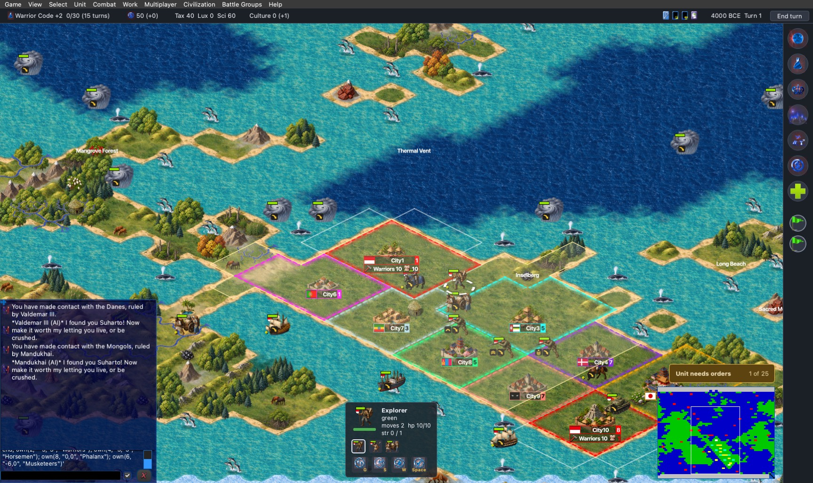

# The city bar's flag as a chip (patch 0049)

Date: 2026-10-19. Issue: #252, found after PR 248 put our own city art into freeciv45iso.

## The problem

The city bar draws the nation flag at the flag sprite's own size. freeciv45iso uses the large flags
(`misc/flags-large.spec`), 120 x 80 canvas pixels, 60 x 40 points at 2x. On a tile 96 points wide that flag is the
biggest thing on a size 1 to 3 city, and the bar sits across the city's lower half: City1, City6, City7 and City9
in `units-cities-1x.jpg` were mostly flag.

## What changed

- **Tileset:** `citybar_flag_height = 32` in `tilesets/freeciv45iso.tilespec`, in tileset pixels (the chip is 48 x 32
  canvas pixels, 16 x 24 points at 2x), about the height of the bar's name row. The key is new, optional and
  defaults to 0, which keeps the flag's own size, so classic and the other tilesets are unchanged. An older client
  ignores it.
- **Client (patch 0049, `client/tilespec.c`, `tilespec.h`, `mapview_common.c`, `gui-qt/canvas.cpp`):** the key is
  read and scaled with the tileset's scale like `svg_height`. In `get_city_desc` the flag's rectangle is scaled to
  that height keeping its shape, so the row is now as high as the text and the bar is narrower by the flag's
  width. The flag is drawn through `canvas_put_sprite_full_scaled`; the Qt client's version now sets
  `SmoothPixmapTransform`, so the 120 to 48 pixel downscale is not jagged.
- The tile's own city flag (`city_flag_offset_x`, in `tilespec.c`) and the unit flags are unchanged.

## Checked

- `scripts/build.sh qt --no-install-deps` on the driver's copy of the fork: the three compiler warnings are the
  old ones (`connectdlg_common.c:302`, `mapview_common.c:1668`, a linker alignment note), none in the new code.
- The ten-city field of `units-cities-field.txt` (open back row, walled front row, sizes 1, 3, 5, 7, 8 on the
  five-size art, flags of ten nations), civ45t as that script describes, freeciv45iso, NightStalker, offscreen on a
  1728 x 1030 screen at 1x and with `QT_SCALE_FACTOR=2` on the 3456 x 2060 screen. The same build and field with
  the tileset key left out is "before".

| Shot | |
|---|---|
| `citybar-flag-test/before-1x.jpg`, `after-1x.jpg` | 1x: the flags go from 60 x 40 to 24 x 16 pixels; the houses, walls and pagodas show |
| `citybar-flag-test/before-2x.jpg`, `after-2x.jpg` | 2x, 1:1: the same; the walled cities (6 to 10) read as walled cities with their bars under them |

Flags stay recognisable at 1x (Portugal, Ethiopia, Mongolia, Denmark, Indonesia in the shot). The name and size
still sit in the bar as before, with the owner colour at the right.

Not checked: other themes, an observer's view, cities with a much longer name, the other tilesets (the key is off in
them), a city at a different map zoom, and the amplio2 tileset.
