# freeciv45iso: the painted terrain on the angled map (issue 190, 2026-10-18)

civ45 plays on the angled map since issue 188 (topology ISO, patch 0032), and John prefers that look. His words:
"convert our painted terrain into angled tiles, and use amplio2 units and cities for now". This note says what
was built, what changed in the client (patch 0033), and how it was checked. Labels: observed (seen in a run or read
in the source), inferred (my reading), unverified (not checked).

## What it is

- **Geometry:** amplio2's 96 x 48 diamond doubled, 192 x 96 px at `pixel_ratio = 2` (patch 0025). On a 2x screen a
  tile is 96 x 48 points like amplio2, and every pixel of the painted ground is drawn.
- **Painted ground:** the same cells freeciv45test uses, cut the same way. `make-freeciv45iso.py` imports
  `make-freeciv45test.py`, so it has the same `PANELS` and `PLAN` from the TERRAIN_GROUND.md runs log, the same
  seamless cutter, the same tone match and the same cool pine. Each 192 px square master is then turned 45 degrees and
  squashed 2:1. A square tile point (u, v) lands on x = (u - v) / 2 + 96, y = (u + v) / 4, so the tile's north edge
  becomes the diamond's upper right edge, as the client draws map north.
  - Each pixel averages 4 x 4 point samples of the master, which wraps, so neighbouring diamonds join as the square
    tiles do.
  - The outline is binary: a pixel belongs to a tile when its centre does, so diamonds never overlap or leave gaps.
- **Shore:** freeciv45test's coastline cells (beach on both sides of a coast, ice next to glacier), turned the same
  way into the client's isometric corner cells (96 x 48, the top, bottom, right and left quarters of the diamond).
- **Blending:** freeciv45test's four wandering masks, turned tile by tile. Each of the 3 x 3 tiles is a diamond in its
  own rectangle, in map order. Land fades into land and water into water (patch 0031).
  - There is no `t.blend_mask_same` in iso, because its strips are square. Two variants of one terrain meet without a
    fade, as they do in amplio2.
- **From amplio2:** everything else, scaled 2x with nearest-neighbour sampling, with its artists' credits kept in each
  spec. That covers units, cities, rivers, roads, specials and resources, bases, fog, borders, grid, select and
  explosions.
  - Left out: amplio2's forest, jungle, hills and mountains overlays, its ocean corner cells, its lake and ice cells,
    and its `t.blend.*` textures. The painted ground replaces them.
  - `misc/citybar` and `misc/overlays` are re-cut, as freeciv45test does.
- **Size:** 8.9 MB, of which 7.7 MB is the painted sheet. freeciv45test is larger (its square sheet alone is 14 MB).
- **Retakes:** when runs 18 to 21 land, add them to `PANELS` and `PLAN` in `make-freeciv45test.py` and run both
  builders. Two builds in a row give identical files (observed).

## Patch 0033 (fork `client/tilespec.c`)

- **Observed, source:** the masks were read only for overhead square tilesets. An isometric tileset got only
  `t.dither_tile`, and amplio2's dither tile is a thin diagonal line, so amplio2 barely blends.
- Now any square tileset can have the masks, overhead or isometric. With them, the client uses the masks in place of
  the dither tile. `t.blend_mask_same` stays overhead only.
- **Observed, run:** the first run drew the blend pieces half a tile too high. They were added at the "full tile"
  offset, which is 0 in overhead view but -H/2 in isometric view (a full iso tile is 1.5 tiles tall), and the next
  tiles painted over most of them.
  - The pieces are one tile in size, so they now go at the tile's own origin.
  - Overhead tilesets are unchanged: there the full tile is the tile, so the offset was 0 before and after (inferred
    from the source; freeciv45test was not re-run on the patched client).
- An unpatched client still loads freeciv45iso and blends it through amplio2's dither tile (inferred).

## Check (observed)

Offscreen client on the driver build (patch 0033 plus `../ui/bar-test/uidrive.diff`), `QT_SCALE_FACTOR=2` on the
1728 x 1030 pt screen, scene `field.txt`.

- The scene paints every civ45 terrain in 3 x 3 blocks, in map coordinates, south of the start stack, on the ISO
  civ45 map. The same game and view were run with amplio2 and with freeciv45iso.
- The client log for freeciv45iso has no tileset error or warning, and amplio2's run has none either.
  - The first build listed `misc/flags.spec` twice and logged 1154 duplicate-flag warnings. That is fixed, and the
    count is now 0.

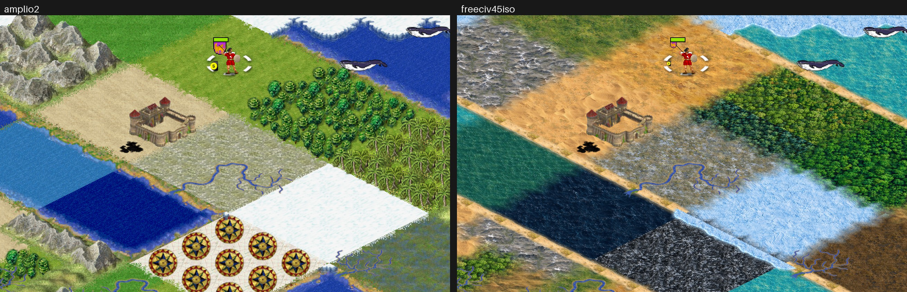

- The whole windows, at half size: `field-window-amplio2.jpg` and `field-window-freeciv45iso.jpg`. The top strip,
  edge column, unit card, what-next button and minimap sit where they do with amplio2.
- Desert into tundra, tundra into glacier, forest into jungle, ocean into lake and lake into deep ocean all fade over
  wandering edges.
  - Beaches run along every coast.
  - The ice edge shows where water meets glacier.
  - amplio2's rivers, specials, cities and units draw on the painted ground.

## Relief for hills and mountains (issue 194, 2026-10-18)

A painted square seen from above, once turned into a diamond, reads as flat ground. Its light also swings toward the
left. That suits grassland, plains, desert, tundra, swamp, glacier and water. Hills and mountains need relief.

**Chosen for now:**
- Hills and mountains draw amplio2's relief overlays over flat painted ground.
  - Hills stand on plains cells (run 6 row 3), mountains on rocky desert (run 19 row 5 since issue 201).
  - The painted hills and mountains stay in freeciv45test.
- Forest, jungle and the cool pine keep the painted canopy, which reads as forest at the angle (picture above).
  Changed by issue 199: in a real game the canopy read flat, so forest and jungle now draw amplio2's trees too.

**How (observed, source and run):**
- The overlays come in 16 forms each, matched to same-type neighbours on the four edges.
  - In the client, a 1 digit in `_n1e0s0w0` means "same type", and hills and mountains join each other.
  - Mountains are tall (96x66 in amplio2, 192x132 here), 12 px lower.
- They go on layer 2, because the land tiles' layer 1 holds the beach.
- So the water tiles' ice edge on layer 2 is now matched as a pair, water against arctic (`t.l2.<water>_cell_u_a_w_w`).
  - As a "same" match, every hill next to water would have drawn an ice edge.
  - The run shows ice by the glacier and none by the hills.
- The painted base was tried too (`--relief-base painted`). amplio2's hill overlay covers the whole diamond and the
  mountains leave only small gaps, so the two bases look almost the same. The flat base also fades into the
  neighbours in plain ground colours.

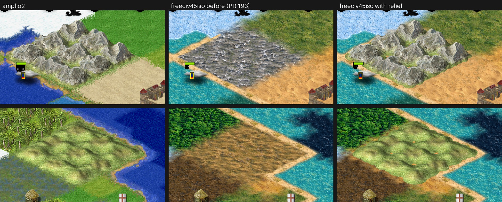

The whole window, half size: `relief-window.jpg`.

**From the FCW and amplio2 study (the parent session's read-only report), checked here:**
- Relief is a separate overlay layer: yes, `hills.spec` and `mountains.spec` hold only `t.l1` overlays.
- Mountains are 96x66: yes.
- Units are 64x48: yes.
- "u.freight and u.container carry a real trademark": **not confirmed**. Stock amplio2's freight truck says "GPL" on its
  side, and the container ship shows no brand at this size. Both stay as stock amplio2 GPL art.
- Only stock amplio2 is used (from the build's data), nothing from FCW's own additions.
- Later ideas, not done:
  - painted iso relief overlays for hills, mountains and forest, as a Codex art job;
  - sparse transparent detail sprites as extra numbered variants (FCW does this; the 3.2 client picks a variant per
    tile).

## The look in a real game (issue 198, 2026-10-18)

The parent session played civ45 with freeciv45iso (size 4, mapseed 21, gameseed 21, revealmap START, turn 1, John's
options) and listed five faults. This section covers the first three. Forest and jungle overlays and a brightness lift
come later. All changes are in `make-freeciv45iso.py`. freeciv45test and the client are unchanged.

1. **"Grassland looks like orange sand."** Observed in the game's save: the start area is mostly plains, with some
   grassland and desert.
   - The plains cells were run 6's golden rows 3 and 4 and run 14's sandy bank, and next to the desert they read as
     sand.
   - The iso build now uses run 6's yellow-green rows 1 and 2.
   - Each terrain was checked by name on the labelled field below. The orange left in the start view is desert, which
     amplio2 paints pale beige, so our sand is more golden.
2. **Boxy coasts.** The beach is narrower and wanders more, and bays are rounded over a wider soft minimum.
   - These are make-freeciv45test.py's `SHORE_*` and `LAND_*` values, overridden for the iso build only (`SHORE`):
     - beach depth on the water side 0.13 to 0.07 of a tile, and on the land side 0.16 to 0.08;
     - wave 0.4 and 0.5 to 0.6;
     - bay rounding 0.03 to 0.15.
   - Lakes keep the shore. Two lake variants were tried:
     - no beach at all;
     - sand on the land side only.
   - Both made a one-tile lake a hard diamond. With the rounded shore it reads as a pond.
3. **Deep ocean as a black hole.** It is graded toward deep blue in CIE Lab (`GRADE`, floor +28 L, +2 a, -20 b).
   - The fades between terrains now reach 37.5 % of a tile (`BLEND_DEPTH`), up from 25 %.
   - A diamond is half as deep across an edge as a square, so the old fades looked short in iso.

**Check (observed):** the same seed and the same 3680 x 2284 device-pixel window as the parent's shot, on the driver
build, offscreen. The crops are at the parent's `mid.png` offset, so the three rows show the same tiles.
- amplio2's run and ours have the same map and start.
- The client log has no tileset error or warning.
  - The first try of "no beach" named a new layer 1 match type "lake". The client refused it, because its initial
    clashes with "land", and the game never started.

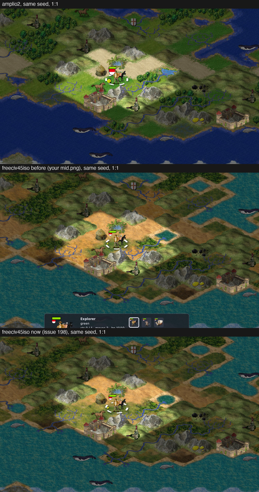

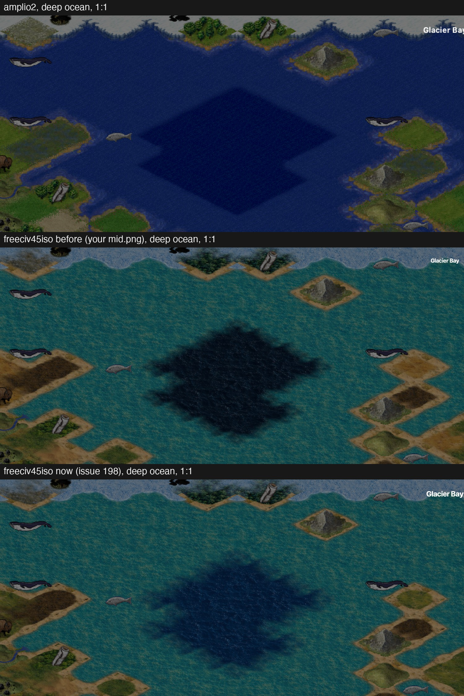

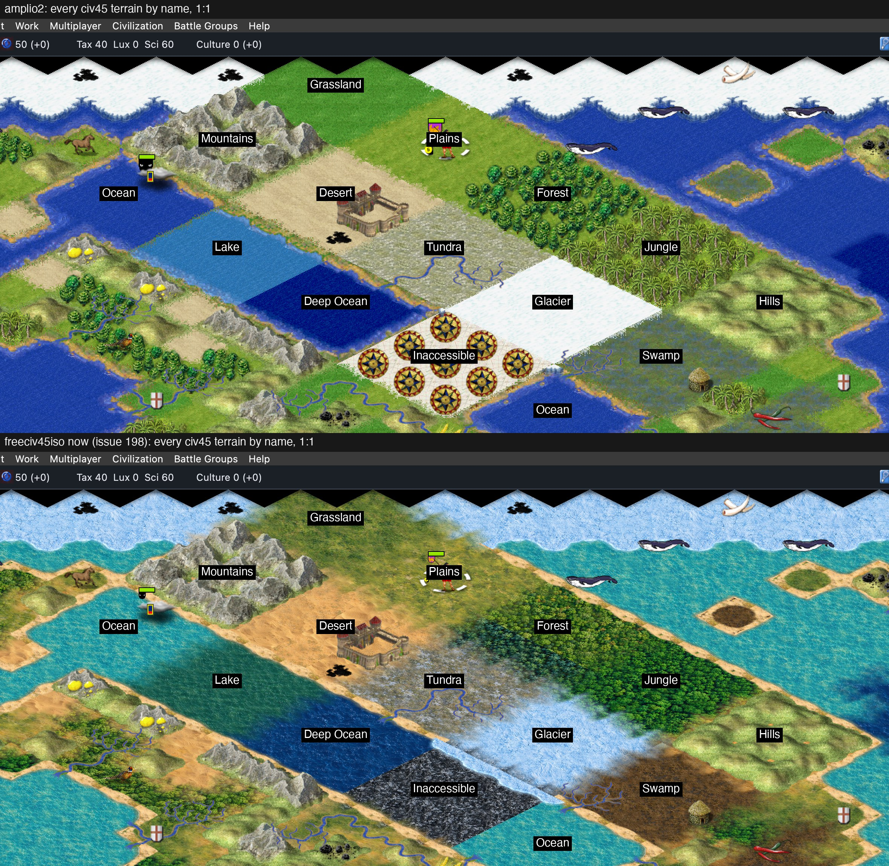

**Still open:**
- Grassland and plains are close in hue: plains are yellow-green, grassland a duller green.
- Desert is golden where amplio2's is pale.
- A diagonal coast still steps tile by tile, as amplio2's does, but softer.
- Forest and jungle overlays and a brightness lift are the parent's items 4 and 5 (issue 199, below).

## Terrain retakes, runs 18 to 21 (issue 201, 2026-10-18)

The art repo kept four retakes (BK-Art PR 66, commit 1e805b1). Both builders now cut three of them, in
`make-freeciv45test.py`'s `PANELS` and `PLAN`:
- **Swamp:** run 18 panel 3 rows 3 and 4. Green marsh with small pools, in place of run 13's brown mud.
- **Tundra:** run 19 panel 2 rows 3 and 4.
- **Rocky desert:** run 19 panel 2 row 5. It is also the ground under the iso mountains (`RELIEF_BASE`).
- **Plains bank:** run 20 panel 8 row 3, in freeciv45test only. The iso plains stay run 6's green rows 1 and 2
  (issue 198), and this bank is the same straw gold that read as sand there.
- **Run 21 row 5 is not cut.** It is the retake of run 11's ice on deep water, which neither builder cuts: civ45 has
  no frozen-sea terrain, and as a deep ocean variant it would turn up on every deep ocean.

**Check (observed):** offscreen, the same seed and window as issue 198, plus the labelled field.
- The client logs show no tileset error or warning.
- At 1:1, tundra shows no grid across the 3 x 3 block.
- The swamp and rocky-desert edges show no ghosting. Run 21's edges are not in the tileset, so they were not checked.
- freeciv45test was rebuilt and its RECORD updated, but it was not run in a game. civ45 is iso now.

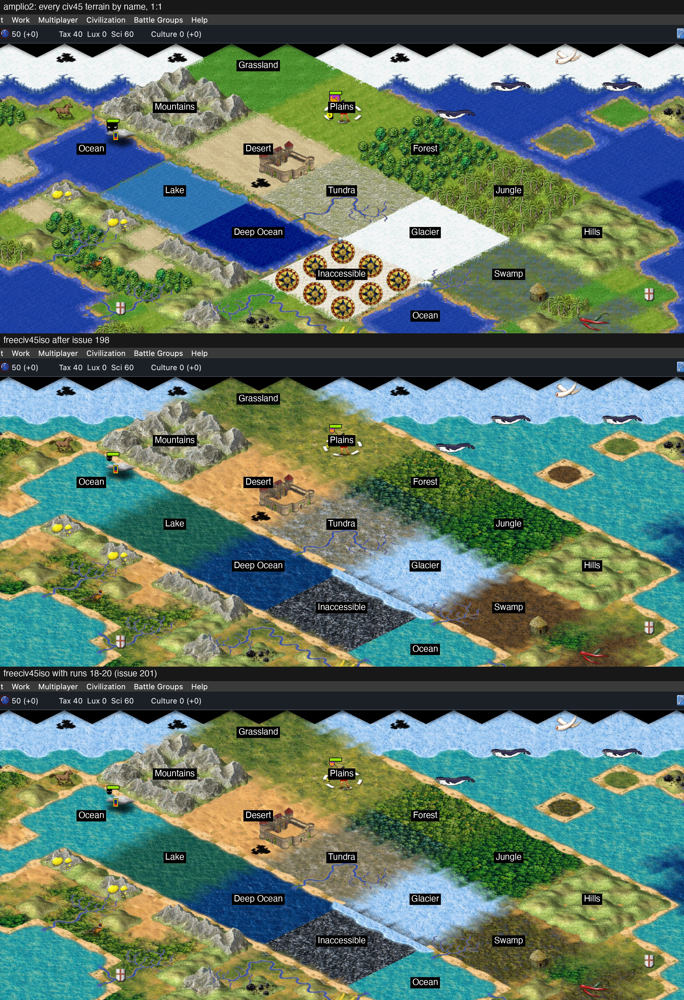

## Forest, jungle and brightness (issue 199, 2026-10-18)

**Forest and jungle now draw amplio2's tree overlays** (`--canopy amplio2`, the default).
- The overlays come from amplio2's `terrain2.spec`: 16 forms each, matched to same-type neighbours. They sit on
  layer 2 like the hill relief, over painted grassland (`CANOPY_BASE`, run 15 rows 1 and 2).
- In the same-seed game and on the field, the trees stand up off the ground the way amplio2's do. The painted canopy
  read as a flat green carpet.
- This is an interim step. The Codex tree props (BK-Art `02_terrain_features`) are meant to replace amplio2's trees;
  the plan is in the shared notes, `freeciv45iso-scatter-plan.md`.
- `--canopy painted` gives back the build of issues 190 to 201.
- The cool pine next to tundra is still painted ground, now under amplio2's broadleaf trees. It shows as a darker
  blue-green floor at the forest's tundra side.

**Brightness: no lift.** Measured on land only (mean luminance of three land boxes in the same-seed crop, observed):

| box | amplio2 | ours | ours, lightness +8 |
|---|---|---|---|
| around the start | 88.2 | 87.4 | 88.8 |
| north-west | 56.9 | 56.1 | 57.3 |
| south-east | 91.4 | 90.8 | 92.4 |

- Our land is already as light as amplio2's. The darker look in the whole window comes from the water.
- **The olive look is hue.** amplio2's land has green above red by 6 to 15 levels; ours by -2 to 8.
  - A land-wide shift toward green (`--land-grade 0,-5,0`) moved red by only about 2 levels, and it would green the
    desert too.
  - The fix is the grassland and plains art, or a per-terrain grade. That is for the art side to decide (`GRADE`
    takes per-terrain offsets).
- `--land-grade L,A,B` stays in the builder, off by default.

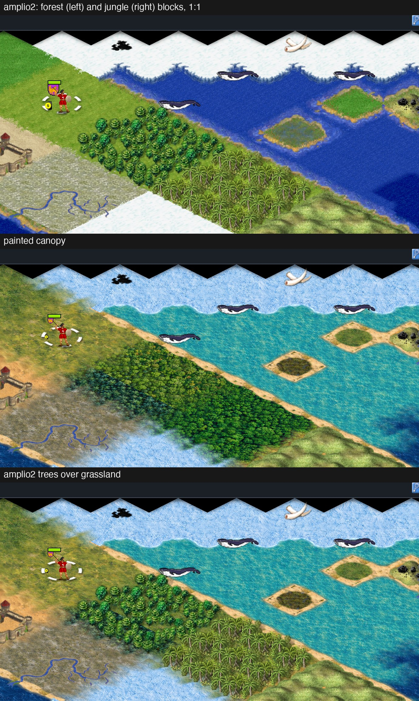

## Our own resources (issue 206, 2026-10-18)

The 21 civ45 resources now draw the Freeciv45 art pack's isometric props. They come from BK-Art PR 64, commit
7e16455, `freeciv45/03_resources`, using the picks in its `RESOURCES.md`.
- The art repo's `tools/props.py` cut each one to a 192 x 96 tile. The prop stands on the tile's foot point with a
  soft contact shadow, which matches amplio2's resource sprites doubled.
- The builder copies them unchanged into `resources.png`, five to a row. `resources.spec` names them, and amplio2's
  sprites for the same tags are dropped from `terrain1.spec`.
- **Only the picks are shipped.** John: "we should only ship the chosen final assets". The tileset gets one
  192 x 96 sprite per tag: no alternates, panels, qa files, 1x copies or art-repo records. They are credited in
  `tilesets/freeciv45iso/RECORD.md`, "Resources", under GPL-2.0-or-later.
  - amplio2's `ts.arctic_oil`, `ts.seals`, `ts.forest_game` and `ts.river_resources` stay, because civ45 doesn't use
    them.
  - `ts.grassland_resources` is new to the tileset (amplio2 has none).
- `--no-resources` keeps amplio2's.

**Check (observed):** mapseed 21, the same window. The client log shows no tileset warning.
- Each resource sits on the same tile and at about the same height as amplio2's. Seen: wine, horses, oasis, coal,
  gold, fish and whales.
- At 2x zoom, the fish and whale water pads read as small splashes, not boxes, both on open water and by the shore.
- Still to check:
  - the land resources that aren't in this view;
  - `ts.oil` on glacier;
  - whether the 1x size reads on a non-Retina screen. The tileset uses only the 192 x 96 tiles at
    `pixel_ratio = 2`.

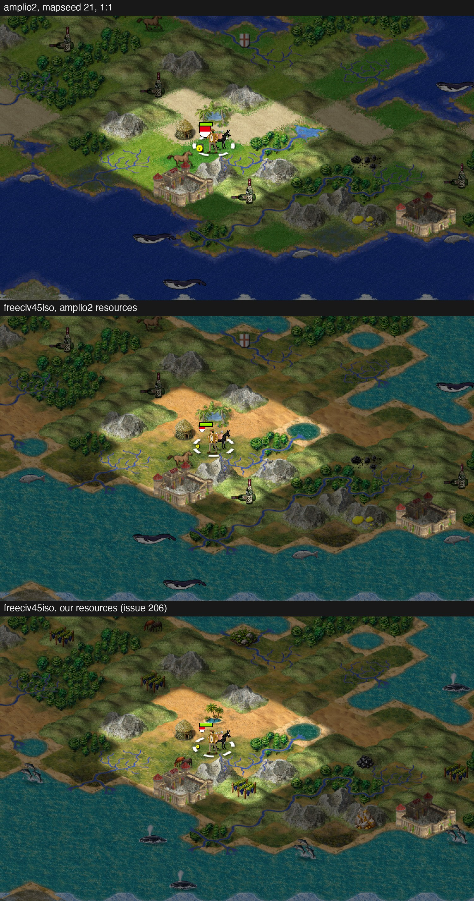

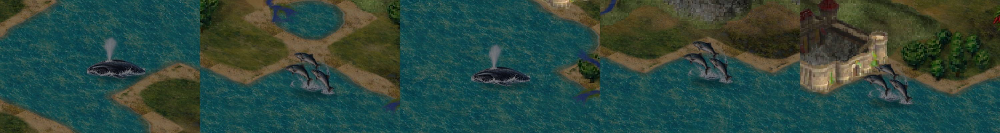

## Desert toward straw (issue 209, 2026-10-18)

John saw the resources picture: the map looks better, but the ground round the start still read as orange sand.
- **Which terrain:** desert, not plains. amplio2's pale beige in that spot matches the colour of its desert sprite.
- **Measured in CIE Lab** (Pillow's 0-255 scale, 128 is neutral; observed):

  | | L | a | b |
  |---|---|---|---|
  | our desert cells (dunes, rocky and bank alike) | 186 | +16 | +44 |
  | amplio2's desert sprite | 197 | +1 | +25 |

- **The fix:** `GRADE["desert"] = (0, -12, -14)`, which moves a and b only. The cells now average a +4, b +30: a straw
  that stays a little warmer than amplio2's.
  - Lightness is unchanged. Mean luminance in a patch of the start desert was 150.3 before and 150.7 after; amplio2's
    is 158.3.
- In the game the patch moved less than the cells (a +12 to +5, b +40 to +33). The beach, the blend into neighbours
  and the oasis share it.
- The client log shows no tileset warning.

## Our trees, hills and mountains (issue 224, 2026-10-18)

Forest, jungle, swamp, hills, mountains and inaccessible now draw the Freeciv45 art pack's standing props. They come
from BK-Art PR 75, commit 04cb963, `freeciv45/02_terrain_features/runN/panelN/post/raw`, placed as its
`TREES_AND_RELIEF.md` ("Runs 1 to 4") says. amplio2's trees (PR 205) and its hill and mountain relief (PR 197) are
gone from the tileset: `terrain2`, `hills` and `mountains` are no longer cut.
- **Baked stands, not single props.** `features()` in the builder bakes a few variants per terrain, each a full tile
  (192 x 144, the diamond plus half a tile of headroom). The client draws one per tile on layer 2 (`layer2_is_tall`),
  picked with `fc_randomly(tile_index, N)`, as the scatter plan in the shared notes chose.
  - Trees: 6 or 7 per forest tile at 0.6, 7 jungle plants at 0.45 with a palm or tree fern now and then, 3 swamp
    pieces at 0.6. Feet stay inside the diamond, spaced by width, sorted back to front.
  - Hills: one per tile at 0.85, foot 22 px below the centre, the bottom 18 % of the alpha faded into the ground.
  - Mountains: one per tile at 0.78, foot 26 px below the centre. The top band is stripped from `peak_spire`,
    `peak_massif`, `peak_twin`, `peak_ridge`, `peak_cliff`, `range_1` and `range_2`, as in the art repo's judge
    script. Inaccessible gets `peak_dark_*` only.
  - Each prop's scale is capped so it stays inside the full tile, which keeps the client's redraw from clipping it.
  - Seeds come from the tag and the variant number, so two builds give identical files.
- **Variants:** forest 12, jungle 12, swamp 8, hills 15, mountains 15, inaccessible 5. Through patch 0030's pairs:
  forest next to tundra gets pines (8), mountains next to tundra get snowy peaks (5), hills next to desert get dry
  hills (5). Tundra and desert get their own layer-2 match types for this.
- **Ground under the props:** run 6 row 1 (the iso plains ground) under hills, rocky desert under mountains (run 19
  row 5), and tundra under the pines (run 19 row 3). Mountains are graded toward grey-brown (`GRADE["mountains"]`).
- **Only the props drawn are shipped.** `features.png` holds only the 87 baked stands, and RECORD.md "Trees, hills
  and mountains" names the 87 props they use, under GPL-2.0-or-later. No panels, qa, judge files or alternates.
- `--features amplio2` brings back the amplio2 trees and relief.

**Check (observed):** mapseed 21, the same window, and the labelled field. The client log shows no tileset warning,
and every terrain draws its stand.

**Limits (findings):**
- Hills no longer join into ranges. Each tile is a separate lump, because variants have no neighbour forms.
- Glacier next to mountains doesn't bring snowy peaks. That would need glacier to share a layer-2 type with tundra,
  and that would draw the ice edge on tundra coasts.
- Inaccessible loses its ice-edge corner layer; the dark peaks replace it.
- At 6 or 7 trees a tile, a forest reads as open woodland rather than a closed canopy.

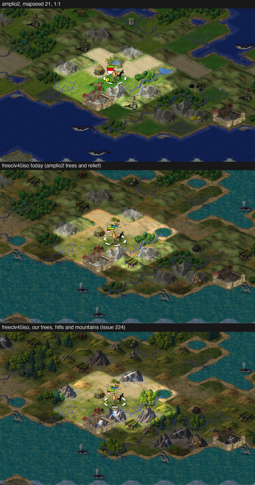

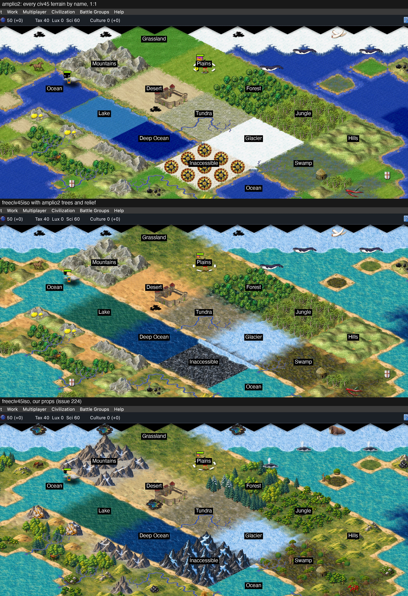

## Set 2: stands, ridges and ranges (issue 229, 2026-10-18)

Set 2 of the trees and relief replaces set 1 for forest, jungle, swamp, hills and mountains. It comes from BK-Art
PR 86, commit 38fd559, `freeciv45/02_terrain_features` runs 5 to 8, placed as `TREES_AND_RELIEF_2.md` ("Runs 5 to
8") says. Inaccessible keeps run 4's dark peaks. It closes #226 (hills don't join), #227 (no snowy peaks by glacier)
and #228 (forest reads as open woodland).
- **Trees (`TREES`):** one stand per variant at 0.82, its foot 24 px below the diamond centre, plus a clump of its
  kind (`CLUMPS`) at 0.65, 44 px to one side and 34 px below. Swamp's stand is at 0.5, and 6 of its 10 variants have
  a small clump at 0.4.
  - forest: broadleaf, mixed and pine stands (each twice) plus the 3 autumn stands, 33 variants, so autumn is on
    about one forest tile in eleven;
  - forest next to tundra: pine and snowy-pine stands, 7;
  - jungle: stands 1 to 5 (each twice), 2 with palms and 1 tall emergent (the mushroom look, so only one), 13;
  - swamp: mangroves, reeds and snags, 10.
- **Hills and mountains (`RELIEF2`):** the form comes from the neighbours along the two grid lines.
  - In the iso view, the client's cardinal neighbours north and south lie on the right-rising line, and east and
    west on the left-rising one.
  - A tile whose own kind is on one line only draws a ridge (hills, 1.1) or range (mountains, 1.15) along it. Its
    foot is a quarter of its width (plus 4 px) below the centre, so the ends meet the next tile's.
  - A tile with its kind on both lines or neither draws a single: a cluster (hills, 0.9) or a peak (`peak_warm_*`,
    `peak_tipped_*`, 0.85), foot 22 px below the centre.
  - Hills next to desert draw dry clusters and ridges.
  - Mountains next to tundra or glacier draw cold peaks as singles and keep the ranges on a line.
  - `range_l1` and `range_l2` lose the edge fragments of the next cell (`largest()`: only the largest piece of
    alpha).
- **Patch 0034** is the client side.
  - A whole-tile layer drawn from variants can also have variants per cardinal form,
    `t.l2.<tag>_<form>_<k>` (and `t.l2.<tag>_<type>_<form>_<k>` for the pair set). Forms without their own set
    draw the usual variants.
  - A `layer2_match_with` that names several types pairs with any of them (mountains: `"tundra", "arctic"`).
  - amplio2's own match (MATCH_SAME) wasn't enough: it loads one sprite per form, so every inner tile of a chain
    would repeat one ridge, and it can't also pair.
  - Each ridge or range is baked once and carries the tags of its line's three forms (and, for ranges, of the cold
    set too).
  - The tileset now needs a client with patch 0034. Without it, the mountains' several-type pair is an unknown
    match style on whole tiles.
- **Size limit:** every variant stays inside the full tile (192 x 144). A stand 165 px tall at 0.82 would reach above
  it, so the tallest stands come out at about 0.73. The widest ranges are held to 192 px (about 1.1).
- **Only the props drawn are shipped:** 118 baked tiles in `features.png`. RECORD.md "Trees, hills and mountains"
  names the 100 props they use, under GPL-2.0-or-later.

**Check (observed):** mapseed 21 in the same window, and the labelled field, on the patched client. The client log
shows no warning.
- Forest and jungle read as closed stands.
- The hills north-west of the start join into one ridge, and the mountains by the south coast into one range.
- The mountain block by the glacier draws cold peaks.
- In the field's 3 x 3 blocks every inner tile has its kind on both lines, so blocks draw singles, as the brief
  says.

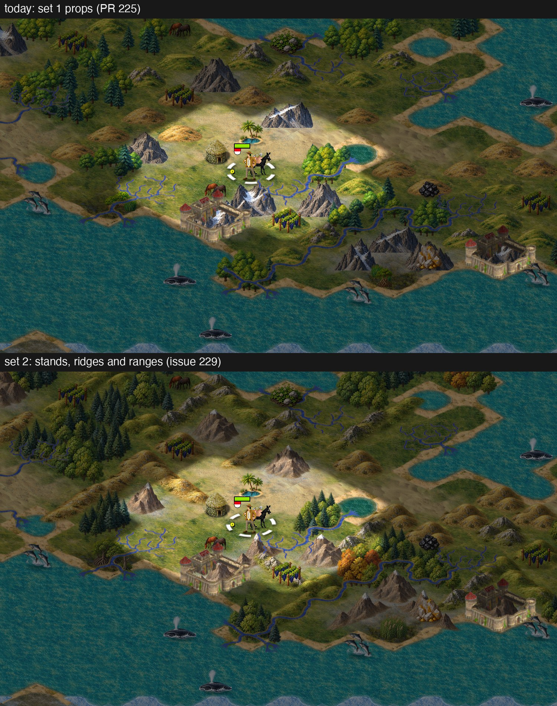

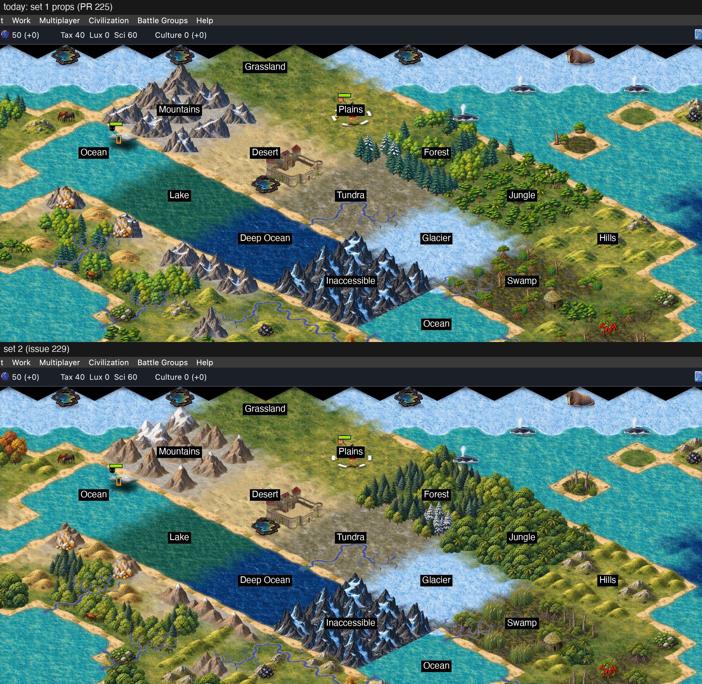

## Units, cities, marks and ruins (issue 245)

The art pack's units and cities (Brothers-Keeper-Art `freeciv45/04_units` and `05_cities`, runs 1 to 5, with a verdict
table per panel in UNITS.md and CITIES.md) replace amplio2's. `--units-art`, `--cities-art` and `--no-bk-units` on the
builder.

- **Units:** the 85 sprites of civ45's `units.ruleset`, one per tag, `u.<name>_Idle` as in amplio2. Each cell is
  cleaned and set at a common size (`tidy`, `UNIT_SCALE` 0.7 and a 150 x 108 cap, so the elephants and the great
  ships still fit), centred on its weight, feet on one line.
  - **Cell 160 x 128, not the 128 x 96 the brief named:** a tall figure (elephants, the great people) or a wide
    ship clipped in 128 x 96. `unit_offset_x` is (192 - 160) / 2 = 16, `unit_offset_y` 0, so a unit stands on the
    tile as the diamond's centre. The flag, activity icon and stack number offsets are amplio2's, still right.
  - **Second takes:** only `musketeers_alt` beat its first take (UNITS.md has the table for the other 14).
  - **Facing:** the art faces left, as amplio2 does; `grenadiers` came out facing right and is flipped
    (`UNIT_FLIP`). The sailing ships were checked on the sheet and face left.
- **Cleaning:** every sprite and every city goes through two steps, because the Codex sheets leave a red or yellow
  fringe in the semi-transparent edge pixels (worst on cities panel 3).
  - `pieces` drops stray specks (a piece under 60 % of the largest, with a 5 px rim kept so shadows and flags stay).
  - `defringe` bleeds the colour of the nearest solid pixel (alpha 200 and up, within 4 px) into every edge pixel
    below that, and leaves the alpha alone, so the edge still blends but no longer carries a coloured halo.
- **Cities:** `city.<style>_city_0..4` and `_wall_0..4` for the ten styles, 192 x 144 cells, `ruins_1` as
  `extra.ruins_mg`. A style's ten sprites share one scale, so a size 1 hamlet stays smaller than its size 17
  city and the walled sprite of a size matches the open one. In iso the walled sprite is the whole city
  (client/tilespec.c), so it carries the buildings too. The index comes from civ45's City_Image effect: sizes 1,
  5, 9, 13 and 17 give 0 to 4.
- **Marks:** `marks.spec`: the 21 activity icons (56 x 48 cells), `unit.vet_1` to `vet_3`, `tired` and `lowfuel`. civ45
  has four veteran levels, so the amplio2 `vet_4` to `vet_9` have no use and are not made. amplio2's
  `veterancy.spec`, `extra_units.spec`, and the activity, unit and city tags are gone.
- **Left on amplio2** (no art made): `unit.maglev`, `unit.outpost`, `unit.airstrip`, `unit.buoy`, `unit.fallout`,
  `unit.oil_mine` and `unit.oil_rig` in `activities.spec`, which therefore still carries amplio2's credit.

**Check (observed):** a civ45 game on the patched client, offscreen. `units-cities-field.txt` makes ten cities
(open in the back row, walled in front), stacks of land and sea units, three veteran levels and units in cities.
Pictures at 2x and 1x:

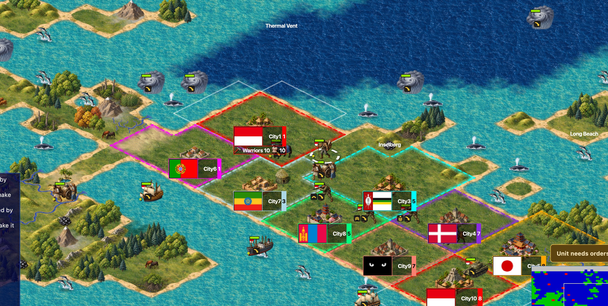

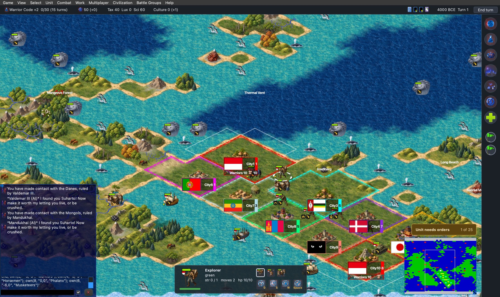

- Units stand on the tile with their flag, activity icon, veteran chevron and stack number in the places the amplio2
  ones had; nothing clips.
- The five city sizes draw in turn. Join City stops at size 8 without an Aqueduct, so the test ruleset (see the
  scene's header) moves the City_Image thresholds to 3, 5, 7 and 8; the sprites are the same index 0 to 4.
- Walled cities draw as whole walled cities; open ones show the houses only.

## Not done, and findings

- Hills and mountains had no relief in the first build (issue 194). They now draw our own props (issue 224).
- **Inaccessible against deep ocean is a hard edge.** It is the same in freeciv45test, because civ45's Inaccessible
  is not in the water class.
- **Two variants of one terrain meet without a fade** in iso (see above).
- **Not checked:** a real Cocoa window on John's screen, an unpatched client, the GTK and SDL clients (which ignore
  `pixel_ratio`), fog of war and borders on the painted ground in a long game, and drawing speed.
- **Units and cities (issue 245), not checked:** all 85 units in one game (the test shows about twenty types), the
  four unit panels' every second take, city sizes 9 to 17 in a real game (only through the shifted thresholds), the
  rulesets other than civ45 (civ54's units and styles are the same names), and a hand-made `unit_offset` on a Retina
  window.
