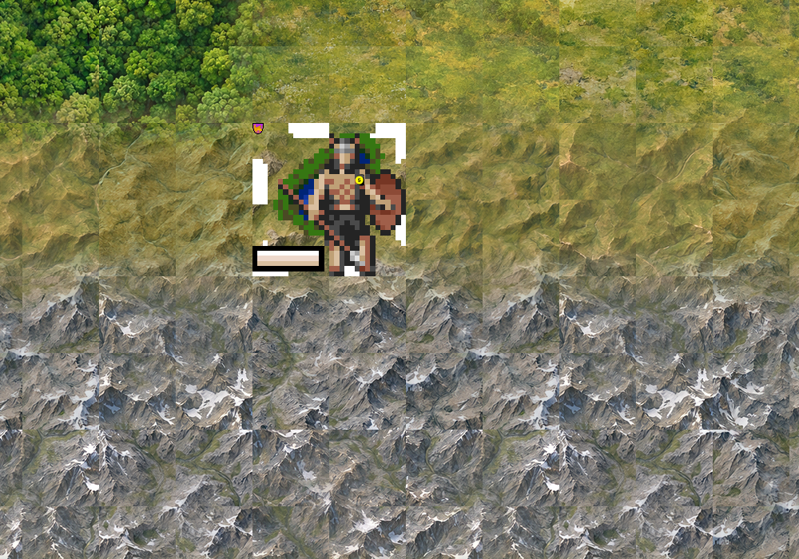

# Retina: the map draws every painted pixel (issue 161, 2026-10-18)

John said the map looks small and soft next to modern 4X games on his 2x display. This note records what was
measured, which of the two fixes was chosen and why, what changed, and how it was checked. Labels: observed (seen
in a run or read in the source), inferred (my reading), unverified (not checked).

## What the client did

- **Observed, source:** every Qt canvas is a plain `QPixmap(width, height)` at the widget's logical size
  (`client/gui-qt/canvas.cpp`, `qtg_canvas_create`), and `map_view::paint` copies the map store 1:1 into the
  widget (`mapview.cpp`). On a 2x screen Qt then doubles every pixel (`ui/qt-today.md` section 5).
- **Observed, run:** an offscreen client at `QT_SCALE_FACTOR=2` on a 3456 x 2060 px screen, a 1728 x 1030 pt
  window like John's, freeciv45test at 96 px: the 13-tile mountain range of `tileset-t0/range.txt` spans about 1230 pt,
  so **a tile is 96 points**, drawn as 192 device pixels with each tileset pixel doubled. The earlier real-screen
  shots agree (`tileset-t0.md`: "each 96 px tile is 192 screen pixels").
- So the map was **not** at half size (48 pt); it was at the intended size with half the resolution. The
  painted terrain is cut as 192 px masters by `seamless.py` and was scaled down to 96 px, then doubled again by
  the OS: the softness John sees is that round trip.

## The choice: both, a density-aware map canvas and a 192 px tileset

| Option | Tile on a 2x screen | Pixels | Verdict |
|---|---|---|---|
| Today: 96 px tiles, plain canvas | 96 pt | 96 px doubled to 192 | soft |
| Density-aware canvas alone, 96 px tiles | 48 pt | 96 px, 1:1 | sharp but **half the size**: the opposite of the ask |
| 192 px tileset alone, plain canvas | 192 pt | 192 px doubled to 384 | twice the size, still soft, 4x the drawing |
| **Both** | **96 pt** | **192 px, 1:1** | the painted masters reach the screen as cut |

A canvas that knows the display's ratio only helps when the art has the pixels to fill it, and art with the pixels
only shows them when the canvas does not throw them away, so the fix is both together. Tying the density to the
display alone would have shrunk every other tileset (trident at 15 pt), so the density is the **tileset's**
declaration instead: a new optional `pixel_ratio` in the `[tilespec]` section, "this many of my pixels make one
point". Tilesets without it are 1 and draw exactly as before.

## What changed

**Fork, patch 0025** (`client/tilespec.c` and `client/gui-qt/`):

- `tileset_pixel_ratio()` reads `tilespec.pixel_ratio` (int or float, 1 to 4, default 1).
- The Qt map canvas is the map widget's size times that ratio; `map_view::paint` draws it into the widget's
  points, so at ratio 2 on a 2x screen each canvas pixel is one screen pixel, and on a 1x screen Qt scales it
  down smoothly.
- Mouse positions go from points to canvas pixels (`map_canvas_pos`, every `mapctrl.cpp` entry point); dirty
  rectangles and the tile info popup go back to points; the minimap, battle log and chat placement use
  `map_widget_width/height` in points.
- Map text (city names, productions) and lines (borders, goto) are drawn at the canvas density, so they keep their
  size; the research tree and other canvases are untouched.
- The city dialog's map and the stack chooser show tileset pixels at the same density, so they keep their old point
  size (both were twice as large in the first run).

**Tileset:** `tilesets/make-freeciv45test.py --tile 192` (now the default; `--tile 96` gives the old build):
painted cells are the 192 px masters with no resample, trident placeholders scale 6.4x, offsets, `svg_height`
(flags) and the blend depth (48 px) scale with the tile, `pixel_ratio = 2` goes into the tilespec, and
`misc/citybar` and `misc/overlays` are re-cut because the client draws them on the map. 5.8 MB in all (was 1.7).

**Test driver** (`ui/bar-test/uidrive.diff`, test code only): `mousetile DX DY` clicks a tile with a real mouse
event through the window, so the point to pixel conversion runs (`clicktile` calls the click handler with canvas
pixels and skips it). `retina/retina.txt` is the check script.

## Pictures (1:1, device pixels, the same map area)

Offscreen client at `QT_SCALE_FACTOR=2`, the `range.txt` scene (forest, hills, mountains, grassland):

- `retina/range-before-1to1.png`: before, 96 px tiles doubled by the OS.
- `retina/range-after-1to1.png`: after, 192 px tiles drawn 1:1. Same layout and size; the ridges, valleys and
  grass blades are the cut masters'.
- `retina/range-after-window.jpg`: the whole window after, half size. Top strip, right column, unit bar,
  minimap and chat sit where they did.
- `retina/overlay-after.jpg`: the city overlay after a real mouse click on the city tile.
- `retina/chooser-after.jpg`: the stack chooser, units at their old point size.

## Checks (observed)

- `retina.txt` on the patched driver build with the 192 px tileset: a `mousetile 2 1` click (831,336 pt) opened
  Testburg's overlay, so the conversion is right (inferred: unconverted, the point would be read as canvas pixel 831,336, about
  four tiles west and two north of the city);
  Enter opened the full dialog with its city map at the old size; a click on the start stack opened the chooser;
  the Nations and Research tabs opened. The client logged no sprite error or warning.
- Same script on a 1x screen (`QT_SCALE_FACTOR=1`): the overlay opened; the map is the 192 px art scaled down
  smoothly, at 96 pt tiles.
- trident (no `pixel_ratio`) on the patched build against the unpatched one: the start view is pixel-identical
  except a 60 x 60 px box around the focus unit, whose selection frame blinks; the click test passes on both.
- Not checked: a real Cocoa window on John's screen (the offscreen runs at scale 2 reproduce the earlier real-screen
  measurement, so I kept windows off his screen), scrolling speed with the 4x larger canvas, and the Zoom
  in/out menu items, which re-read the tileset at a scale and leave `pixel_ratio` alone (inferred to work).

## Size

Tiles stay at 96 points. If the map should be bigger, two knobs: View > Zoom in (each step x1.2, now from 192 px
art, so less soft than before), or a default of 128 pt tiles by declaring `pixel_ratio = 1.5` (192 px drawn into
256 device pixels, a mild up-scale). That is John's call; nothing changes it tonight.

## Findings filed

- Other clients (GTK, SDL) ignore `pixel_ratio` and show freeciv45test at 192 pt.
- Upkeep icons from `misc/small.spec` are drawn on the map at half their old size (only widgets were meant to
  use that file), and nation flags in widgets doubled with `svg_height`.
