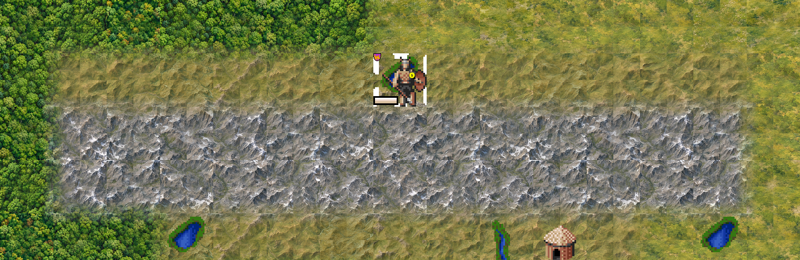
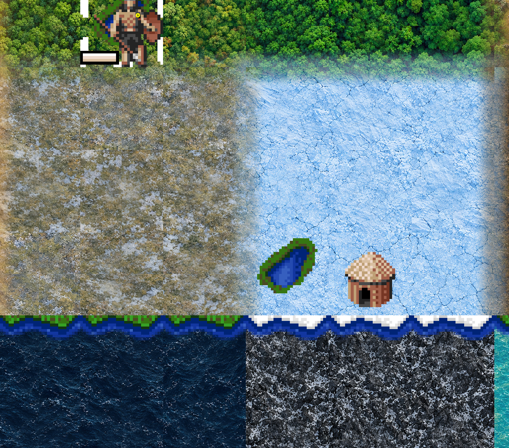
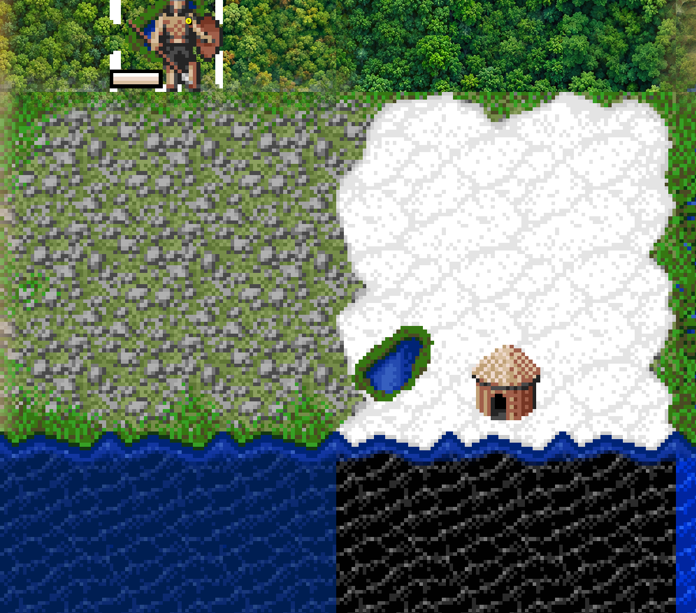
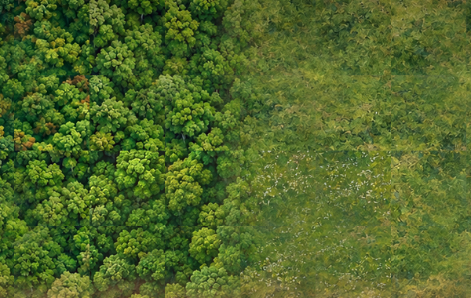
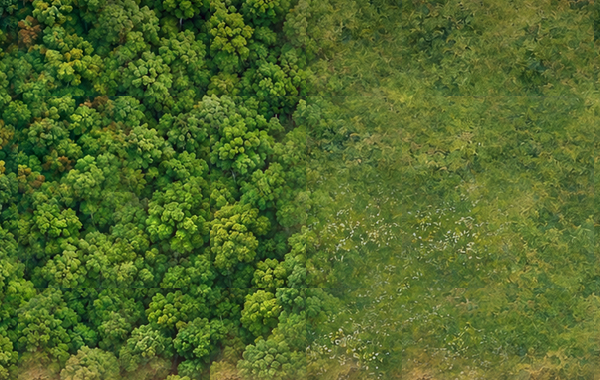
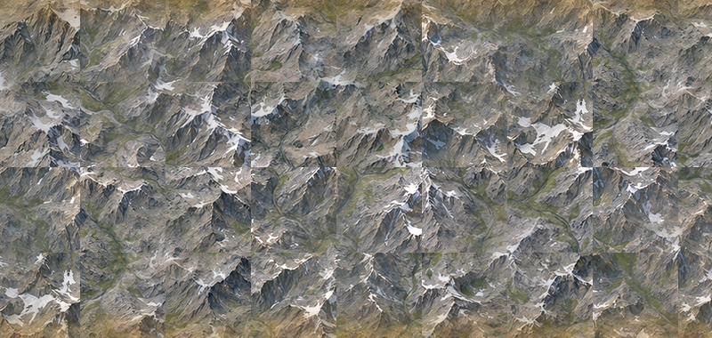
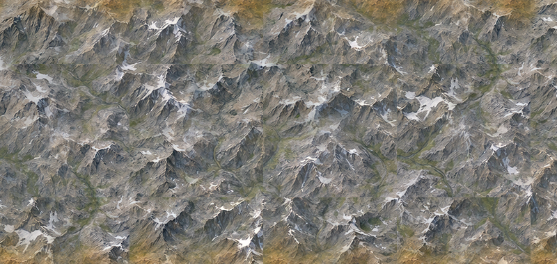

# Tileset T0: painted ground in the Qt client (issue 74, 2026-10-17)

The first look at Freeciv45's own tileset format in a running game: `tilesets/freeciv45test`, 96 px overhead
squares, every tag the civ45 ruleset needs (trident's sprites scaled 3.2x as placeholders) and the grassland and
plains ground from run 6 of the painted terrain sheet, ten variants each. Where each sprite came from is in
`tilesets/freeciv45test/RECORD.md`; `tilesets/make-freeciv45test.py` rebuilds it. This covers plan row T0 and
the loading half of T1 (`notes/freeciv45-plan.md`, "Look").

## How it was run

`scripts/tileset-look.sh logs/tileset-t0-run4` (the script is new in this change): a local server from
`~/freeciv-builds/qt` plays civ45 (its installed copy) on a size 3 map with `revealmap START`, seeds 7 and 7,
aifill 4; the Qt client autoconnects with `-t freeciv45test` and `FREECIV_DATA_PATH` starting with this repo's
`tilesets/`, on its own options file. After the start every client window is captured, then the human's first
unit is moved one tile east three times from the server's Lua console (`unit:move`), with captures 0.3 s, 0.8 s
and 3 s after each move. The client's `smooth_move_unit_msec` is set to 1500 for the run so a move animation
would be long enough to capture. Runs 1-4 and two auto-accept runs are in `logs/tileset-t0-*` (git-ignored);
the three pictures kept are in `notes/freeciv45/tileset-t0/`:

- `map-start.jpg`: the map at turn 1, half size.
- `painted-ground-1to1.png`: a 1:1 crop (Retina pixels, so each 96 px tile is 192 screen pixels) with painted
  plains and grassland next to trident's water, swamp and coast.
- `moves.jpg`: crops around the start stack: the map before, then 0.3 s, 0.8 s and 3 s after move 1, and 0.3 s
  and 3 s after moves 2 and 3.

For John's own client: `~/.freeciv/3.2/freeciv45test.tilespec` and `~/.freeciv/3.2/freeciv45test` are symlinks
into this repo (logged in `notes/installed.md`), so `freeciv-qt -t freeciv45test` or the tileset menu finds it.

## What works

- The client loads the tileset complete with civ45: no missing-sprite error, no warning (run 1 had one
  duplicate-tag warning, fixed by dropping trident's `t.l0.grassland1` from the re-cut `tiles.spec`).
- The painted ground draws and the variants show: adjacent plains and grassland tiles differ in shade. The
  client's variant choice (tile index hashed, `client/tilespec.c` `MATCH_NONE`) spreads the ten cells well.
- Three units of movement on the new ground (`moves.jpg`): the explorer leaves the stack, the stack keeps its
  "+2 units" label, the focus box follows. Nothing broke at 96 px: coast cells (48 px corners), the 288 px nuke
  sprite grid, roads, rivers, fog, city sprites and the unit sheet with its 1 px borders all re-cut cleanly.
- Trident's unit sprites at 3.2x nearest are blocky but readable; the selection box, hit point bar and flag
  sit where they should.

## What looks wrong

1. **Hue of the grassland.** At map scale the run 6 meadow reads olive to yellow-green and is close to the
   plains in tone; next to trident's saturated green hills and forest it looks dry. The 30 % check in the
   run's RECORD.md saw the same ("not strictly monotonic", flower drifts). A judgement for the next sheet run:
   grassland wants more green than gold.
2. **Straight tile edges between variants.** Each cell is seamless with itself, but the ten cells differ in
   brightness, so a 2 x 2 block of different variants shows its tile boundaries as straight lines
   (`painted-ground-1to1.png`, the three plains in a row). Rule for the sheet: variants of one terrain need the
   same edge tone and density, or the cutter needs a cross-variant blend. Filed in the art repo
   (Brothers-Keeper-Art issue 26, with findings 1 and 3).
3. **Cutter ghosting.** The half-shift blend leaves a faint cross and doubled marks in the middle band of
   some cells; at 96 px it is faint but visible once seen (r2c3's light patch, the plains' earth patches).
4. **Scale at 96 px.** The LANCZOS 192 to 96 step keeps the painted detail; nothing is blurry, but the
   finest marks turn to noise. 96 px masters cut straight from the panel (about 240 px interior per cell) would
   skip a resample; worth comparing in T1 (#81). One caveat on every blur judgement here: the Qt map ignores
   the display's pixel ratio (plan row Q1), so on this Retina screen the whole map is drawn at 1x and shown
   doubled; the softness that adds is the client's, not the art's.
5. **Trident on top of paint.** Rivers (blue strokes with green banks) and the coast cells (a green fringe
   around land) are trident's, so a gold plains tile by the sea or on a river gets a green border and a
   pixel-art river through it. Hills, forest, mountains and the specials are whole trident tiles, so the map
   is mostly 1991 pixel art with painted patches. All of that is T1's placeholder work (#81); the painted ground
   itself is fine.
6. **No move animation in Qt.** With `smooth_move_unit_msec` at 1500 the frames 0.3 s and 0.8 s after the
   move still show the unit on its old tile, and the 3 s frame shows it on the new one, with no in-between
   frame in any of the three moves (and the pixel diff between the 0.3 s and 0.8 s frames is empty). The
   generic animation loop (`client/mapview_common.c:2716`, `move_unit_map_canvas`) only calls Qt's
   `gui_flush`, which is `mapview_wdg->update()`, a repaint request that nothing services while the loop
   blocks; only the GTK clients set `frame_by_frame_animation`. So the client freezes for the animation time,
   then the unit jumps. This confirms plan row Q1 (#82); the default 30 ms makes the freeze invisible.
7. **The tileset suggestion dialog** still pops ("Modpack suggests using trident", issue 53); it is a separate
   window, so the map capture is clean, but a player who clicks "Load tileset" leaves the test tileset.
8. **One client crash.** Run 3's client crashed 1.5 s after launch (crash report
   `~/Library/Logs/DiagnosticReports/freeciv-qt-2026-10-17-153034.ips`, `EXC_BAD_ACCESS` at 0x8, stack
   `client_handle_packet` into the tileset setup near `tileset_setup_city_tiles`; the build has no debug
   symbols, so the names are the nearest exports) right after logging `Loading tileset "trident"`, which is
   the reread message, although the client was started with `-t freeciv45test` and nobody answered the
   dialog. Runs 1, 2 and 4 and the two auto-accept runs (which reread trident on purpose from freeciv45test
   and from amplio2 and did not crash) did not reproduce it. Issue 80 has the report path.

Not done: moving the unit with the client's own keyboard or mouse. macOS refuses scripted keystrokes
(`osascript is not allowed to send keystrokes`, an Accessibility grant John would have to give), so the moves
came from the server; the drawing path is the same (the client animates any unit move it is told about), but
the goto line, the keyboard handler and the click handler were not exercised.

## What T1 still needs

- Own placeholders at 96 px for everything that frames the painted ground: coast and lake cells (48 px
  corners, `t.l0.coast_cell_*`), rivers (`road.river_s_*`, 16 plus 4 outlets), roads and rails, irrigation and
  farmland, fog and darkness cells, the grid. Flat colour or scripted shapes beat scaled trident here.
- The other terrains from the next sheets (hills, forest, jungle, mountains, desert, tundra, arctic, swamp,
  and water) as numbered variants like grassland and plains; the matching sprites trident uses for them
  (`_n0e0s0w0` sets) are not needed for whole-tile variants.
- Units, cities, specials and the small overlays at 96 px (sheets 3 to 5 of the plan's T2), with
  `unit_flag_offset`, `city_flag_offset` and `occupied_offset` set for the new sprites.
- The sheet rules from findings 1 and 2 above (Brothers-Keeper-Art issue 26), and a decision on 96 px masters
  versus 192 px masters scaled. The placeholder work is issue 81; the move animation is issue 82; the script's
  hang when the server dies at start (same as harness-test.sh's old #66) is issue 79.
- A client that does not need the suggestion dialog: either `preferred = "freeciv45"` in civ45's
  `game.ruleset` once the tileset has its final name, or auto-accept.

## Forest and jungle from panel 4 (issue 126, 2026-10-17)

Panel 4 of the terrain sheet is in `freeciv45test` now: ten forest cells from run 8 rows 1-2 (r2c2 and r2c4
autumn), ten jungle cells from run 8 row 3 and run 9 row 4, cut and wired like the run 6 ground (forest and
jungle lose trident's 16 edge-matched sprites and draw numbered variants; sources in
`tilesets/freeciv45test/RECORD.md`). Pine is not in: see below.

### How it was run

Two new options in `scripts/tileset-look.sh`: `--serv LINE` adds a server setting before the start and
`--at-start LINE` sends a server command once the game runs. Natural maps put only a few forest and jungle tiles
in the start view, so the main look paints a 13 x 7 patch around the first unit (default map, seeds 7) with fog
of war off, because a fogged tile keeps the terrain the player last saw:

    PATCH='lua cmd local n = 0; for p in players_iterate() do if p:is_human() then for u in p:units_iterate() do local x0, y0 = u.tile.nat_x, u.tile.nat_y; for dy = -3, 3 do for dx = -6, 6 do local t = find.tile(x0 + dx, y0 + dy); local name = (dx <= -3 and "Grassland") or (dx <= 1 and "Forest") or "Jungle"; if t then edit.change_terrain(t, find.terrain(name)); n = n + 1 end end end; log.normal("tileset-look: patch of %d tiles around %d,%d", n, x0, y0); break end end end'
    scripts/tileset-look.sh OUT --port 5731 --moves "" --serv "set fogofwar DISABLED" --at-start "$PATCH"

(columns -6 to -3 from the unit grassland, -2 to 1 forest, 2 to 6 jungle). A generated map was checked too:
`--serv "set wetness 80" --serv "set temperature 70" --serv "set mapseed 11"`. The runs used scratch builds through
`--tilesets`; the one without olive pine is byte-identical to the committed tileset. The client loaded it with no
sprite error or warning in every run. Pictures, all from the Qt client on this Retina screen, so each 96 px tile is 192 screen
pixels:

- `forest-jungle-1to1.png`: 1:1 crop of the patch: run 6 grassland (left), forest, jungle (right).
- `forest-jungle-map.jpg`: the whole map window at 40 %.
- `generated-map-1to1.jpg`: 1:1 crop of the seed 11 map: forest (one autumn tile) and jungle among
  grassland, hills, salt flats and trident's swamp.
- `olive-pine-1to1.jpg`: the same patch with run 9's olive pine added as two more forest variants.

### What it shows

1. **Forest and jungle read right at 96 px.** The forest is a leafy broadleaf roof with crowns of mixed size;
   the two autumn cells read as autumn without shouting; the pine accents in r1c2 and r1c4 show only as a few
   darker blue-green crowns. The jungle is clearly a different terrain: darker, bluer green and finer-grained. Nothing turns to noise
   the way the finest grass marks did, because a canopy is texture at every scale.
2. **Against the run 6 grassland the forest is the better green.** Forest averages about RGB 74,109,35; the
   meadow next to it reads yellow-olive and dry. That is finding 1 above again, now with a target: grassland
   should sit between this forest and the plains, not next to the plains. The forest-grassland boundary is a
   hard straight tile edge (whole tiles, no transition), which looks like a field edge and is acceptable.
3. **The variant brightness steps show, less than on grassland.** On the 4 x 7 forest block the tile grid is
   visible softly; in the jungle it shows mostly where the darkest and lightest cells land. Mean luminance at 96 px:
   forest 68-103 (spread 35), jungle 50-76 (27), against grassland 85-166 (81) and plains 122-196 (74).
   **r3c5 is the dark outlier** as expected: luminance 50, a dark square wherever it lands; r3c1 is the light end
   (76). Every row was prompted "light to deeper green left to right", which builds the steps in.
4. **A light line across the middle of the tiles.** Besides the tile edges, many tiles show a faint light
   horizontal line half way down near their left and right edges. All 20 cells are lighter at the top than at the
   bottom (top 20 px minus bottom 20 px: +3 to +27 luminance, 16 cells +12 or more; left minus right has no
   common sign), and the cutter's half-shift wrap puts that top-meets-bottom seam across the middle. Brothers-Keeper-Art
   issue 35.
5. **Mist specks.** The pale mist puffs in r3c1 and run 9's r4c1, r4c3 and r4c5 repeat as small light specks,
   one per tile of that variant. Faint; the only detail that reads as a motif.
6. **Coasts.** Trident's green coast fringe around land now frames forest and jungle too (finding 5 above).

### Pine

Run 9's pine row is two colour families: cool blue-green c1-c3 and warm olive c4-c5.

- **Cool pine is left out.** It belongs on forest next to tundra or glacier, and Freeciv 3.2's tilespec cannot pick
  a whole-tile cell set by neighbour terrain: a whole-tile layer either picks a numbered variant by tile index or
  one of 16 sprites by whether each neighbour has the *same* match type, and whole-tile `MATCH_PAIR`/`MATCH_FULL`
  are "Not yet defined" (`fc_assert(FALSE)` in `client/tilespec.c`, loader and drawing). Corner cells with
  `MATCH_PAIR` do see neighbours, but only as quarter-tile overlays, and glacier is a `water` match on layer 1.
  The hooks that would work (a client patch for neighbour-chosen variant sets, a Boreal Forest terrain in the
  ruleset, or a latitude rule) are written up in issue 127.
- **Olive pine does not join the temperate forest.** Added as `forest11` and `forest12` (`--olive-pine`), the two
  cells show as dark squares with black gaps between star-shaped crowns among the broadleaf tiles
  (`olive-pine-1to1.jpg`; luminance 62 and 58 against 68-103): a patchwork. The committed build leaves them out.

### For the next art prompt

- Same mean lightness across all five cells of a row; put the light-dark variety inside each cell
  (Brothers-Keeper-Art issue 26, comment of 2026-10-17).
- No light gradient across a cell, top to bottom included; measure the edge bands in QA (issue 35).
- Jungle: no mist or pale patches at all; retake r3c5 at the row's mid lightness or drop it (issue 36).
- Grassland: match its green to this forest's family rather than the plains (issue 26).
- Pine: decide its terrain hook first (issue 127); if pine stays a forest look, one colour family only.

## Variants matched in tone (issue 138, 2026-10-17)

John saw hard square edges all over the painted ground. Inside one terrain they came from finding 2 above: each of
the ten cells is seamless with itself, but the cells differ in lightness and colour, so wherever the client puts
two of them side by side the boundary is a straight step. No new art was made: `tilesets/make-freeciv45test.py`
now matches the cells of each terrain to each other before it scales them to 96 px (`match_tone`: in CIE Lab each
channel of each cell gets the terrain's mean level and mean contrast, contrast scale held to 0.75-1.33; details and
the before/after luma table in `tilesets/freeciv45test/RECORD.md`). Only `terrain45.png` changes; `--no-tone-match`
rebuilds the old sheet byte for byte.

### How it was checked

A 25 x 17 field around the start stack was painted from the server's Lua console, grassland west of the stack and
forest from it eastwards, fog of war off, and the Qt client was shot through the in-process driver with no window
on screen (`QT_QPA_PLATFORM=offscreen` on a 1600 x 1000 virtual screen; the shot is the widget's own grab, so 1 px
per tileset pixel). `scripts/ui-drive.sh` takes the tileset, the extra server lines and the screen through new
`FREECIV_DRIVE_*` variables and now runs offscreen unless `FREECIV_DRIVE_VISIBLE=1`:

    FREECIV_DRIVE_PREFIX=<driver build>/qt FREECIV_DRIVE_TILESET=freeciv45test FREECIV_DRIVE_TILESETS=<build out> \
    FREECIV_DRIVE_SERV="set fogofwar DISABLED" FREECIV_DRIVE_QPA="offscreen:configfile=$PWD/notes/freeciv45/tileset-t0/screen-1600x1000.json" \
    scripts/ui-drive.sh notes/freeciv45/tileset-t0/field.txt <outdir> 5741

once with a scratch build made with `--no-tone-match` and once with the new one (the driver build is the fork at
0baacdb plus `notes/freeciv45/ui/bar-test/uidrive.diff`; same seed, so the same tiles get the same variants).
Pictures: `tileset-t0/variant-tone-before.jpg` and `variant-tone-after.jpg` (whole window, grassland left, forest
right, the chat box over the bottom left). `scripts/tile-edge-steps.py` (new) measures the tile grid in a shot: the
mean difference between the 8 px bands on either side of each tile edge, against the same measure across the
tile's middle line, which is the terrain's own variation:

| field | tile edges before | tile edges after | tile middles (both) |
|---|---|---|---|
| grassland (71 edge segments) | 30.5 | 5.2 | 7.9 |
| forest (97 edge segments) | 14.6 | 6.8 | 8.2 |

### What it looks like now

- **The patchwork is gone.** The grassland field reads as one meadow instead of a chequerboard of gold and olive
  squares, and the forest as one canopy; the tone step at a tile edge is now smaller than the variation across the
  middle of a tile.
- **Still visible, faintly:** the texture itself is cut at the edge. A clump of grass or a crown of trees stops at
  a straight line where the next cell's pattern starts, so at 1:1 a careful eye still finds the grid, more in the
  forest (big crowns) than in the meadow. Matching tone cannot fix that; a soft blend across the edge or
  edge-matched cells from the cutter could.
- **Still visible:** the light line across the middle of many cells (finding 4 above, Brothers-Keeper-Art issue 35)
  is untouched, since it is inside each cell; now that the edges are quiet it is the most visible straight line in
  the forest.
- **Autumn is quieter.** The two autumn forest cells keep their orange crowns but are pulled towards the forest's
  green with the rest; at map scale they read as a hint of autumn rather than an orange tile.
- The grassland is still gold-olive, not green (finding 1): the tone match brings every cell to the meadow's mean
  and leaves that mean alone.
- Edges between different terrains (the grassland-forest line in the pictures) are unchanged; that is issue 141's
  overhead blending.

## Terrains blended at the edge (issue 141, 2026-10-17)

The other half of John's hard edges: where two terrains meet, overhead view draws a straight line, because Freeciv
3.2 blends terrains only in isometric view (`client/tilespec.c`: the blend sprites are quarter tiles at iso offsets,
masked by `t.dither_tile`, which is loaded for isometric tilesets only; "This only works in iso-view!").

**Fork patch 0019** (`patches/0019-Tilespec-blend-neighbouring-terrains-in-overhead-vie.patch`, client only): an
overhead square tileset that provides `t.blend_mask` gets blending. The mask is 3 x 3 tiles with a terrain's own tile
in the middle and says how strongly that terrain shows in each of the eight tiles around it. For every terrain with
a blender the client crops eight whole-tile sprites from it through the mask, one per direction; a tile whose
terrain has `blend_layer` then draws, after that layer, the sprite of each neighbour of another blending terrain:
across the edge for the four sides, into the corner for the diagonals, and a corner is skipped when a side neighbour
next to it already has the corner's terrain. Without `t.blend_mask` the old code runs untouched: isometric
tilesets, trident (no blend_layer) and hex2t (overhead hex, which sets blend_layer) draw as before.

**freeciv45test**: `blend.spec` carries the mask, generated by `make-freeciv45test.py` (0.5 opacity at the shared
edge, smoothstep down to 0 at 24 px, a quarter tile; corners are the product of the two edge fades, so they join the
edges without a seam). Both sides of an edge blend, so the edge itself is half and half and each terrain thins out
over 24 px on the other side. The nine land terrains have `blend_layer = 1`, under trident's coast cells; the five
drawn from trident's edge-matched sprites (desert, hills, mountains, swamp, tundra) fade out with their
all-neighbours-alike sprite through `t.blend.<terrain>` aliases. Arctic, lake and ocean do not blend. Details in
RECORD.md.

### How it was checked

The same offscreen driver run as for issue 138, with `notes/freeciv45/tileset-t0/mix.txt`: a painted patch around
the start stack with grassland next to a 5 x 5 forest block (with one grassland tile inside it), a 5 x 5 plains
block and a 3 x 3 hills block, plus a lone forest and a lone hills tile in the grassland, fog of war off. The driver
build is the fork at 0baacdb with this patch and `uidrive.diff` as it was at 204b400; "before" is main's tileset (no blend_layer, no
mask) in the same patched client, "after" is the new build. The patch was then rebased onto 0a0ff8e (patch 0018,
which does not touch `tilespec.c`) and the fork built clean with the same 48 compiler warnings as before, none in
`tilespec.c`. The review then found that the Qt client's zoom reloads the tileset at a scale that rounds the mask
and the tile size separately (a 288 px mask next to 112 px tiles comes out 335 px, not 336), which the first
version answered by switching blending off, and where Qt would have left a 1 px strip unmasked; the patch now cuts
each direction's piece of the mask out as a whole tile (transparent where the mask is short) and allows a pixel per
tile. Rechecked in the driver build: the exact mask draws the same terrain as before, and a scratch tileset with a
287 px mask blends the same, with no error and no strip.

- `tileset-t0/blend-before.jpg`, `blend-after.jpg`: the whole window (the chat box covers the bottom left).
- `tileset-t0/blend-closeup.jpg`: 1:1 crops, before left and after right: the forest block with its grassland hole;
  the hills block next to the plains; the lone forest and hills tiles.

Mean luma in 8 px bands across two edges (offsets in px from the edge, 192 px of edge averaged):

| edge | -40 | -32 | -24 | -16 | -8 | 0 | +8 | +16 | +24 | +32 |
|---|---|---|---|---|---|---|---|---|---|---|
| forest \| grassland, before | 79 | 86 | 85 | 83 | 86 | 132 | 131 | 133 | 127 | 124 |
| forest \| grassland, after | 80 | 86 | 89 | 96 | 110 | 107 | 120 | 130 | 127 | 124 |
| grassland \| plains, before | 130 | 133 | 137 | 133 | 132 | 166 | 169 | 169 | 168 | 167 |
| grassland \| plains, after | 130 | 133 | 138 | 142 | 147 | 149 | 157 | 166 | 167 | 166 |

A one-pixel step of 46 (forest) and 34 (plains) becomes a ramp about 48 px wide.

Isometric and other tilesets unchanged: the same game was shot with an unpatched and a patched driver build on
trident (overhead), amplio2 (isometric, `set topology ISO`) and hex2t (overhead hex, `set topology HEX`). Trident is
pixel-identical. Amplio2 differs only on the focus unit, and so do two runs of the unpatched build (it blinks).
Hex2t differs only where AI units stand on another tile in each run; its terrain and blending are identical.

### What it looks like now

- **Grassland and forest** meet in a soft band: the canopy thins into the meadow over a quarter tile and the meadow
  reaches a quarter tile under the trees, and the block's corners round off. A lone forest tile reads as a grove, not
  a pasted square. A grassland tile inside the forest becomes a clearing with soft sides.
- **Grassland and plains** fade gold into olive with no line; at map scale the edge is gone.
- **Grassland and hills**: the line around trident's hills is softened, and a lone hill sits in the meadow as a soft
  blob. The hills themselves are still trident's pixel art at 3.2x, so the clash of styles stays until hills are
  painted (panel 5 and issue 81).
- **Still visible:** in the fade band the neighbour shows as its own texture at half strength or less, so at 1:1 the
  forest edge looks like a thin veil of trees over the grass rather than single trees standing in it; and the band
  is the same width all along an edge, so a long edge still reads as a straight, soft line. Painted edge cells, or a
  noisy mask (the band wandering in and out), would break that up; neither is in this change.
- **Still visible:** the faint variant grid inside a terrain (issue 138's residue) and the mid-cell light line
  (Brothers-Keeper-Art issue 35); trident's rivers, lakes and resource icons sit on top unblended.
- Not checked here: desert, jungle, mountains, swamp and tundra edges (they blend by the same rule), a long game, the
  GTK and SDL clients (they share `tilespec.c` and the same `crop_sprite` mask formula, but were not run), and
  performance (eight extra sprites per blending terrain at load; at most eight extra draws per tile).

## Hills and mountains from panel 5 (issue 151, 2026-10-17)

Panel 5 of the terrain sheet is in `freeciv45test` now: thirteen hills from run 7 rows 1-3 and nine mountains from
rows 4-5, cut and wired like the other painted terrains. Hills and mountains lose trident's 16 edge-matched sprites
and their `t.blend.*` aliases, draw numbered variants, are tone matched per terrain (hills luma 85-149 to 121,
mountains 96-157 to 124) and blend at the edges through patch 0019 like grassland and forest. Left out: r1c1, r2c1
and r4c3, the three cells the art log names for a shared diagonal ridge rhythm; ten green hills, three dry brown
ones and nine mountains remain, so no weak cell was needed. Sources in `tilesets/freeciv45test/RECORD.md`.

### How it was checked

`notes/freeciv45/tileset-t0/range.txt` paints a patch around the start stack from the server's Lua console: a
13 x 2 mountain range with a row of hills above it and nine hills below, forest west of the stack and grassland east
of it, so hills and mountains meet both; fog of war off on a `revealmap START` civ45 game. The server was
`~/freeciv-builds/qt` (fork 016a41b, patches 0001-0020); the client was the same fork plus
`notes/freeciv45/ui/bar-test/uidrive.diff`, built in a scratch prefix, run offscreen on a 1600 x 1000 virtual
screen at 1 px per tileset pixel (no window on screen; ports 5751-5753):

    FREECIV_DRIVE_PREFIX=<prefix with that server and client> FREECIV_DRIVE_TILESET=freeciv45test \
    FREECIV_DRIVE_TILESETS=$PWD/tilesets FREECIV_DRIVE_SERV="set fogofwar DISABLED" \
    FREECIV_DRIVE_QPA="offscreen:configfile=$PWD/notes/freeciv45/tileset-t0/screen-1600x1000.json" \
    scripts/ui-drive.sh notes/freeciv45/tileset-t0/range.txt <outdir> 5751

once with main's tileset (trident hills and mountains) and once with this build (byte-identical to the committed
tileset); same seed, so the same tiles. The client loaded it with no sprite error or warning. A first build left
the three dry brown hills out, expecting a brown patchwork like the olive pine; a run with them in showed no
patchwork (below), so they are in.

- `tileset-t0/hills-mountains-1to1.png`: 1:1 crop of the patch: forest top left, grassland right, the hills row
  with the unit, the range, the lower hills.
- `tileset-t0/hills-mountains-map.jpg`: the whole window.
- `tileset-t0/hills-mountains-closeup.jpg`: 1:1, the east end of the range before (trident, left) and after.

### What it shows

1. **Mountains read right at 96 px.** The range is grey broken rock with snow on the crests and dark gullies, seen
   straight down; it reads as high country at a glance and as a range, not as a row of pasted peaks. The slight
   oblique faces the art log mentions do not show at this size.
2. **No ridge rhythm across the range.** With r4c3 out, no cell's ridge pattern repeats as a visible beat along 13
   tiles; ridges run in many directions. What all cells share is the light from the upper left, which gives the
   range one even grain. That is right for a map, but it makes the range a uniform slab (point 5).
3. **Hills read as hills only up close.** At 1:1 the folds and valleys are clear and they look like rolling
   country. At map scale they are hard to tell from the grassland next to them: mean colour of the hills row
   L 134, a -3, b 30 against the grassland's L 138, a -8, b 40 (CIE Lab), a difference of about 12, where forest is
   about 44 from grassland and mountains about 37; across the hills-grassland edge the mean luma goes 121 to 133.
   Trident's dark green humps (closeup, left) were easier to spot. Finding, Brothers-Keeper-Art issue 37: hills need
   their own value or hue at map scale, which a greener grassland (issue 26) would also help.
4. **The dry hills mix in.** The tone match moves r3c1, r3c3 and r3c5 to the hills' shared mean, so they show as
   warmer variants, not brown squares, and pull the hills slightly towards ochre and away from the grassland.
5. **Blending.** Hills fade into grassland and forest, and mountains into hills, grassland and forest, over the 24 px
   band with no hard line; the forest's crowns thin out over the rock at the range's west end. But a range drawn
   from whole mountain tiles is a rectangle of rock with soft edges: no foothills, no ridge running out into the
   plain. The mask is the only transition, the same straight band as issue 148 (comment added there).
6. **Variant edges.** The tone steps at tile edges inside the range are below the tiles' own variation (7.9 against
   8.7, `scripts/tile-edge-steps.py`, 31 segments), so no checkerboard; but sharp ridge lines stop dead at tile edges,
   so the grid shows faintly as texture breaks, more than in grassland or forest. Finding, issue 152.
7. **The wrap line.** Run 7's cells are lighter on the left than the right (24 of 25 cells, up to +31 luma between
   the outer 20 px bands; top minus bottom +8 or more in 13), from the upper-left light. The cutter's half-shift puts
   that seam inside the tile, so a faint vertical as well as a horizontal light line can show mid-tile; at 96 px it is
   faint in this patch. Comment on Brothers-Keeper-Art issue 35.
- Not checked: a long game, other clients (GTK, SDL), hills and mountains next to desert, tundra or swamp (trident
  placeholders, which blend by the same rule), and the lone mountain and lone hill tiles in the script, which were
  off the view.

## 192 px tiles at pixel_ratio 2 (issue 161)

Since issue 161 the tileset is built at 192 px with `pixel_ratio = 2`: the fork's Qt client (patch 0025) draws the
map at two pixels per point, so tiles stay 96 points and a Retina screen shows every pixel of the painted masters.
The 1:1 pictures above were taken with 96 px tiles doubled by the OS. Reasons, pictures and checks:
`notes/freeciv45/retina.md`.

## Every terrain painted (issue 173, 2026-10-18)

With the art repo's overnight queue finished (runs 10 to 17), `freeciv45test` paints the ground of every terrain the
ruleset draws: grassland, plains, forest, jungle, hills, mountains, desert, tundra, glacier, swamp, ocean, lake, deep
ocean and inaccessible, 182 cells in all. Which run and cells each terrain uses, and the cells left out on purpose:
`tilesets/freeciv45test/RECORD.md`, "Painted ground: every terrain". `make-freeciv45test.py` now takes the art folder
(`--art`) instead of one option per panel, and cuts every cell as `seamless.py --level` does, so the generator's
light gradient no longer wraps into a light band across the tile.

What changed in the tilespec besides the variants:

- Desert, tundra, swamp, glacier and the four water terrains drop trident's edge-matched or corner sprites for
  layer 0, like the land terrains before them.
- Glacier keeps layer 0 only. Trident draws its ice cap on layer 1, and in the first run that cap covered the
  painted glacier with white pixel art.
- Glacier now blends with its land neighbours. Desert, swamp and tundra fade out from their first painted variant,
  not from trident's sprites through the old `t.blend.*` aliases.
- Water keeps trident's layers 1 and 2, so trident's coast pieces still draw the shore over the painted water.
  That stays until the coastline builder exists (issue 81).

**How it was checked (observed).** `tileset-t0/all-terrain.txt` runs offscreen at `QT_SCALE_FACTOR=2` on the
1728 x 1030 pt screen. It paints 3 x 3 tile blocks next to the start stack:

| Row | Blocks |
|---|---|
| 1 | Grassland, Plains, Forest, Jungle, Hills |
| 2 | Mountains, Desert, Tundra, Glacier, Swamp |
| 3 | Ocean, Lake, Deep Ocean, Inaccessible, Ocean |

The client logged no sprite error or warning. A duplicate-tag warning for `t.l0.inaccessible1`, which trident also
has, showed in the first run and is fixed. The same scene was also run on the build before this change.

- `tileset-t0/all-terrain-window.jpg`: the whole window, half size.
- `tileset-t0/all-terrain-window-before.jpg`: the same scene on the build before.
- `tileset-t0/all-terrain-after-1to1.png` and `tileset-t0/all-terrain-before-1to1.png`: 1:1 device pixels, the
  same area. It shows the jungle edge, tundra, glacier, deep ocean and inaccessible.

What the pictures show:

1. **Every block is painted.** Before, desert, tundra, glacier, swamp and the water were trident's flat pixel art.
   Now each one reads as its terrain:
   - glacier is cracked blue-white ice;
   - deep ocean is dark swell, the ocean clear teal and the lake darker green-teal;
   - inaccessible is black broken rock with ice.
   Grassland, hills and jungle changed too, to their newer runs (15, 16 and 17): a greener meadow, dry ochre hills
   and a jungle without mist.
2. **The land blends.** Glacier fades into the jungle and tundra beside it over the same 48 px band as the other land
   terrains, and tundra into jungle, desert and swamp.
3. **The water does not blend.** Ocean, deep ocean, lake and inaccessible meet with a straight hard edge. Trident's
   corner sprites used to shade one water depth into the next, and the painted water drops them. Its shores are
   trident's coast pieces scaled 6.4x: a blocky blue and green (white next to glacier) zigzag between painted
   tiles. Both are the coastline builder's job (issue 81, comment added there).
4. **Faults the runs log already names show in game.**
   - Tundra is busy, and its tile grid shows as steps in the blue-grey snow patches (run 12).
   - Swamp reads as brown dirt with no water (run 13).
   - The plains bank cells pull plains towards a lighter straw. The tone match moved them to the plains' mean, and
     the five run 6 rows 3 to 4 cells and the five bank cells now differ in texture only.

Not checked:
- glacier next to ocean beyond this patch;
- desert, tundra and swamp in a generated map's real layout;
- other clients;
- any zoom level.

## Wandering edges and variant fades (issues 148 and 152, 2026-10-18)

Two faults were left after the blending of issue 141:

- **Issue 148:** the edge between two terrains ran as a straight soft band.
- **Issue 152:** inside a field of one terrain, two different variants side by side stopped dead at the tile edge.
  Mountains showed it most: every ridge cut off at the tile edge, so a range read as a grid of rock squares.

Both are fixed in the client (fork patch 0028), with masks from the tileset builder.

**Tileset.** `blend.png` holds five masks (`tilesets/freeciv45test/RECORD.md`, "Wandering edges and variant fades"):
- four wandering masks for the fade between two terrains;
- one straight 36 px band, `t.blend_mask_same`, for two variants of one terrain.

**What the client does (patch 0028, `client/tilespec.c`):**
- **One mask per edge.** For each edge between two terrains, the client picks one of the tileset's masks
  (`t.blend_mask`, `t.blend_mask_2` and up). The choice comes from the edge's position: the west or north tile's
  index and the edge's direction. Both tiles of an edge get the same mask, so their fades meet. The corners are the
  same in every mask.
- **Variant fades.** Between two different variants of one terrain, the neighbour's variant fades in across the
  shared edge and corner, through `t.blend_mask_same`. This applies to the layer the tileset blends. A corner is
  left out when a tile beside it already shows that variant.
- **Memory.** These pieces are cut to the quarter tile next to the neighbour, and each is made the first time it is
  drawn. At most that is 182 cells x 8 directions, about 33 MB at 192 px.
- **Other tilesets.** A tileset without the new tags draws exactly as before.

**How it was checked (observed).** `tileset-t0/range.txt` ran offscreen at `QT_SCALE_FACTOR=2` on the patched driver
build. The before run used the tileset from before this change; the after run used the new masks.
- `tileset-t0/blend-edge-before-1to1.png` and `-after-`: the forest/grassland edge north of the range.
- `tileset-t0/blend-range-before-1to1.png` and `-after-`: inside the mountain range.
- `tileset-t0/blend-window-before.jpg` and `-after-`: the whole window, half size.

What the pictures show:

1. **The tile grid inside a terrain is gone at 1:1.** Before, the grassland showed tile lines and the mountains a
   grid of rock squares. After, the textures cross the edges. `scripts/tile-edge-steps.py` (its new pixel-step
   measure) puts numbers on it. The table gives the mean luma step between the two pixels on either side of a tile
   edge, then the same across the tiles' middle lines, at origin 1566,484 and tile 192:

   | Area | Before (edge / middle) | After (edge / middle) |
   |---|---|---|
   | Mountains | 43.0 / 23.1 | 12.6 / 21.5 |
   | Grassland | 24.2 / 15.1 | 9.0 / 14.3 |
   | Forest | 49.0 / 27.9 | 13.5 / 25.9 |

   The tone step at the mountain edges also halved, from 6.7 to 3.4, against 7.2 to 7.6 across the middles.
2. **The edge between two terrains wanders.** The forest/grassland edge pushes in and out along its length, by up to
   about 30 px either way, and the band is patchy instead of an even veil. The edge as a whole still follows the
   tile line, as it has to, and it pinches back to the plain band at every tile corner. Over a long edge that pinch
   is a faint rhythm.
3. **What is still there.**
   - Where two variants cross-fade, the line is a little softer than the texture around it: the after values above
     are below the middles. At 1:1 this reads as a faint blur rather than a cut, and it is hardest to see in forest
     and grassland.
   - A few short lines remain in the range. These are corners where a variant's neighbour on one side shows that
     same variant, so the corner piece is left out.

**Other tilesets (observed).** I ran trident and amplio2 (isometric) on the build before and after. Their start
views are identical except the blinking focus-unit box (60 x 60 px on trident, 152 x 84 px on amplio2).

**Not checked:** other clients (patch 0028 is in `client/tilespec.c`, which every client uses, but only the Qt client
was run), a long game, and scroll speed with the extra pieces.
