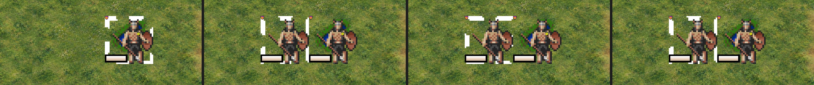
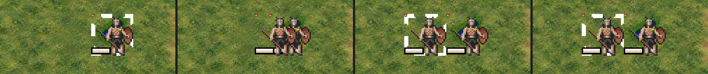

# Units slide between tiles (issue 82, 2026-10-18)

In the Qt client a moving unit jumped to its new tile, and the whole client stopped responding for the length of
the move. This note says why, what changed (fork patch 0029), and how it was checked. Labels: observed (seen in a
run or read in the source), inferred (my reading), unverified (not checked).

## Why the unit jumped

- **Observed, source:** `move_unit_map_canvas()` in `client/mapview_common.c` has two paths. With
  `frame_by_frame_animation` it queues an animation, and the GUI steps it with `update_animation()`. Without it, it
  runs its own loop: it redraws the unit at each step, then sleeps until the next one, for `smooth_move_unit_msec`
  in all.
- **Observed, source:** the GTK 3 and GTK 4 clients call `set_frame_by_frame_animation()`. The Qt client did not, so
  it took the loop path (as SDL 2 still does). Qt paints only from its event loop, and the loop never returned to it
  during the move, so no step was ever painted: the client froze, then showed the unit at its new tile.

## What changed (patch 0029)

- `client/mapview_common.c`: a new `set_animation_start_callback()`. `animation_add()` calls the callback when the
  first animation is queued, and `animation_pending()` says whether any are left.
- `client/gui-qt`: `qtg_ui_init()` turns on frame by frame animation and sets the callback. The callback starts a
  16 ms timer on the map widget. Each tick runs `update_animation()` and `flush_dirty()`, and the timer stops when
  nothing is queued.
- GTK and SDL are untouched: they never set the callback.
- **Side effect (observed, source):** in frame by frame mode common code has no smooth centring yet (its own TODO),
  so "centre on unit" now jumps instead of gliding. Battle and explosion animations take the same queue, so they no
  longer freeze the client either (inferred, not run).

## Check (observed)

`slide.txt` with the test driver (`../bar-test/uidrive.diff`, which now logs each line's time and sets integer
options): an offscreen client at `QT_SCALE_FACTOR=2`, `smooth_move_unit_msec` at 1500, freeciv45test. The server's
Lua console moves the start Warriors one tile west, twice, and the map is shot 0.3, 0.8 and 3 s after each move.
"Before" is the fork at patch 0028 with the driver; "after" adds patch 0029.

Time from the move command to each shot, from `drive.log` (expected about 0.4 s, 1.6 s and 4.5 s with the driver's
pacing):

| | move 1: shot a | shot b | shot c | move 2: shot a |
|---|---|---|---|---|
| before | 1.93 s | 3.18 s | 6.08 s | 1.90 s |
| after | 0.50 s | 1.70 s | 4.60 s | 0.50 s |

Before, the client could not run the driver's next line until the 1.5 s move loop ended, so every shot is late by
about the move's length.

- Before: in shot a the Warriors already stand on the new tile, and the frames in between were never shown.
- After: in shot a (0.5 s into the 1.5 s move) the Warriors are partway across, overlapping both tiles; by shot b
  they stand on the new tile.

Not checked: a real Cocoa window on John's screen, where the timer runs the same way (inferred); a unit's goto
orders over several tiles (each step queues one more animation, inferred to chain); a battle animation.
